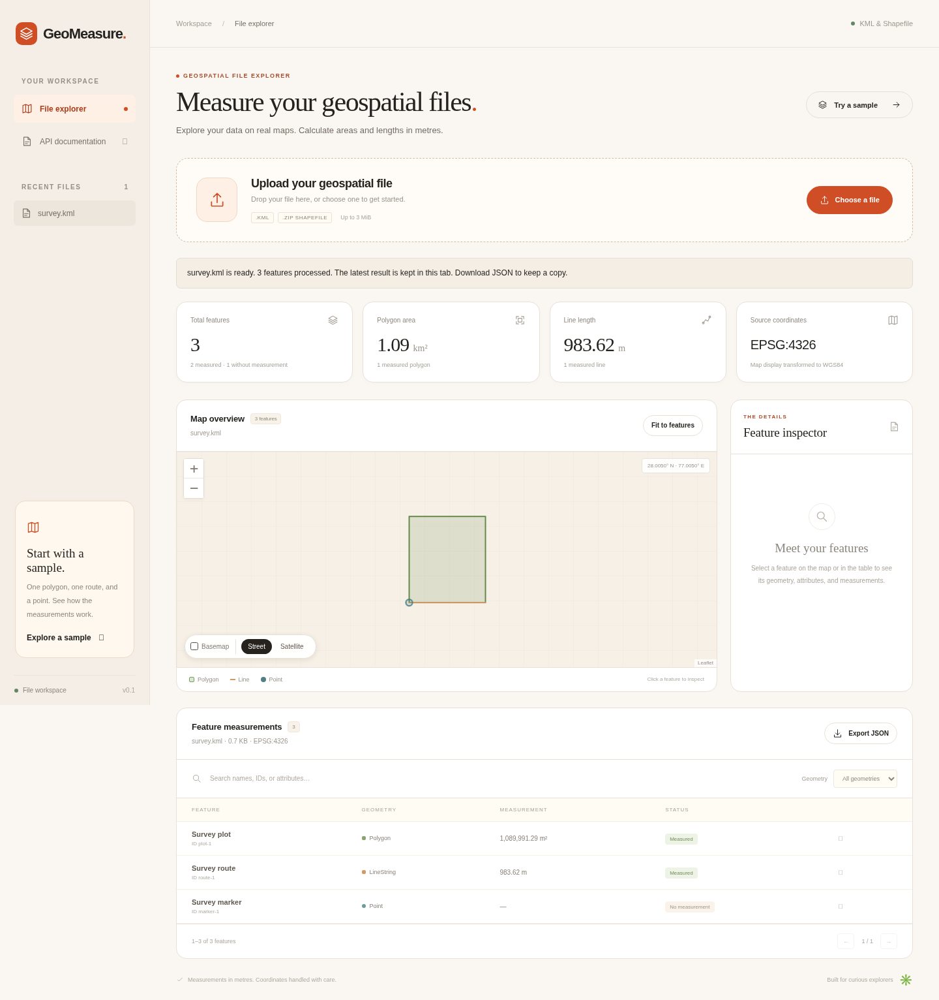

# GeoMeasure

Area and length measurements for KML files and Shapefiles, with a map to inspect the results.

[Live demo](https://geo-spatial-api.vercel.app/) · [API docs](https://geo-spatial-api.vercel.app/docs) · [Technical reference](docs/reference.md)

[](https://geo-spatial-api.vercel.app/)

Upload a file or try the included sample. The app shows each feature's geometry, attributes, source CRS, and measurement. Select a feature on the map or in the table, filter the results, and download them as JSON.

OpenStreetMap provides streets and place names beneath your features by default. You can turn it off to view the outlines alone; basemap tiles need an internet connection.

Built with Python, FastAPI, PyShp, Shapely, pyproj, and Leaflet. The frontend is plain HTML, CSS, and JavaScript.

## Run locally

You'll need Python 3.12+ and [uv](https://docs.astral.sh/uv/getting-started/installation/).

```sh
git clone https://github.com/akashdeep070/geo.git
cd geo
uv sync --locked
GEO_STORAGE_MODE=none uv run --locked uvicorn app.main:app --host 127.0.0.1 --port 8000
```

Open `http://127.0.0.1:8000` and click **Try a sample**. It contains a polygon, a line, and a point.

<details>
<summary>Windows PowerShell</summary>

```powershell
git clone https://github.com/akashdeep070/geo.git
cd geo
uv sync --locked
$env:GEO_STORAGE_MODE = "none"
uv run --locked uvicorn app.main:app --host 127.0.0.1 --port 8000
```

</details>

The command above uses the same database-free flow as the demo. For local persistence, omit `GEO_STORAGE_MODE=none`; when no database URL is set, results will be saved in SQLite under `data/`.

## Supported files

| File | What to include |
| --- | --- |
| KML | A `.kml` file using the KML 2.2 namespace |
| Shapefile | A `.zip` with one matching `.shp`, `.shx`, `.dbf`, and `.prj` dataset; `.cpg` is optional |

Polygon and MultiPolygon features get an area in square metres. LineString and MultiLineString features get a length in metres. Points are shown without a measurement. Invalid, empty, and unsupported geometries get a status and explanation.

Polygon holes and multipart features are supported. Missing Shapefile CRS information is rejected rather than guessed. KMZ and remote KML NetworkLinks are not supported.

## API

Upload using the multipart field `file`:

```sh
curl -fsS -F 'file=@examples/survey.kml' \
  https://geo-spatial-api.vercel.app/api/process/ -o measurements.json
```

The response contains `file` metadata, a `features` array with measurements, and a WGS84 GeoJSON `map`. Source geometry stays in its original CRS.

| Method | Route | Returns |
| --- | --- | --- |
| POST | `/api/process/` | Metadata, measurements, and map geometry |
| GET | `/api/config/` | Upload limits and storage mode |
| GET | `/health` | Readiness status |
| GET | `/docs` | Interactive API documentation |

With SQLite or PostgreSQL enabled, `POST /api/files/` stores results. `GET /api/files/{id}/` retrieves metadata, and `GET /api/files/{id}/measurements/` retrieves measurements. These routes return **410** in the database-free demo.

[Request and response examples, errors, and storage configuration](docs/reference.md#api)

## How it works

```text
Upload → validate file → read features → project and measure → return results
```

`parsers.py` reads KML or extracts the Shapefile components from a checked ZIP. It passes each feature to `measurements.py`, which validates the geometry and transforms it from the source CRS to WGS84, then to a local projection centred on the feature.

Polygon area uses Lambert azimuthal equal-area (LAEA). Line length uses azimuthal equidistant (AEQD). Both use metres, so geographic coordinates are never measured directly in degrees. `map_data.py` prepares separate WGS84 geometry for Leaflet.

```text
app/          API routes, parsing, measurements, and optional storage
web/          Frontend source and generated page
examples/     Sample KML
tests/        API and storage tests
scripts/      Frontend build, browser checks, and source packaging
docs/         Screenshot and technical reference
```

## Design decisions

- **FastAPI:** typed request and response models keep the API contract visible in OpenAPI.
- **PyShp for Shapefiles:** the original Fiona reader failed on Vercel because a GDAL dependency needed `libexpat.so.1`. PyShp removes that runtime dependency. Fiona is kept only for generating independent test fixtures.
- **A projection per feature:** this avoids assuming a single UTM zone for every dataset. These are planar measurements for local and regional data; large or dateline-crossing geometries need more care.
- **Optional storage:** the demo returns everything in one request. SQLite supports local saved results; PostgreSQL supports shared persistence.
- **A bundled frontend:** CSS, JavaScript, and Leaflet are embedded in the generated page so its styling and controls can load in previews that cannot fetch sibling assets.

## Deploy to Vercel

Import this repository in Vercel, use the **FastAPI** preset, and keep the root directory as `.`. Leave the install command automatic and the Output Directory empty. The checked-in `vercel.json` supplies the build command and sets `GEO_STORAGE_MODE=none`.

The demo accepts files up to **3 MiB** and returns up to **4 MiB** of JSON. Local uploads allow **20 MiB**.

Results are temporary in the demo. The latest result can be restored after a refresh in the same tab when browser storage is available. A new browser session starts empty, and result URLs cannot be shared. Download the JSON to keep or share a result.

[Deployment options and troubleshooting](docs/reference.md#deploy-to-vercel--no-database)

## Development

```sh
uv run --locked pytest -q
uv run --locked ruff check .
uv run --locked ruff format --check .
uv run --locked python scripts/build_frontend.py --check
```

Tests cover metric reference values, projected CRSs in metres and feet, polygon holes, altitude preservation, DBF encodings, malformed input, archive safety, and storage behavior. PostgreSQL integration tests need a disposable test database.

Edit `web/index.template.html`, `web/styles.css`, or `web/app.js`, then run `uv run --locked python scripts/build_frontend.py` and commit the generated `web/index.html`.

[Browser checks and packaging commands](docs/reference.md#development-and-checks)

## Learning

Correct units are only part of the measurement problem: the source CRS, projection choice, and geometry validity all affect the result. The tests compare measurements against independent geodesic references instead of checking only that an endpoint returns successfully.

Deployment exposed a separate issue. A build could pass locally while failing at startup in Lambda because of a missing native library. Checking the extracted Vercel function in the Lambda runtime caught that difference.

Serverless storage also changes the API design. Without a shared database, a later request cannot reliably retrieve an earlier upload. Returning the full result in the upload response lets the demo work across separate function instances.

## Future work

Larger uploads and background processing, persistent shareable results, and better handling of global or dateline-crossing data. Before wider production use, the app also needs authentication, rate limiting, and a retention policy for stored results.
